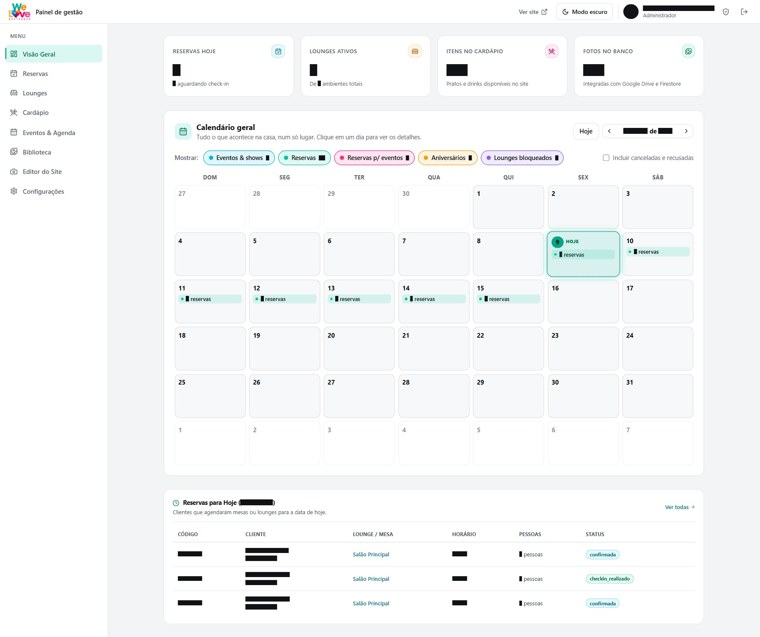

<!--
  repository-metadata:
    stars: 14213
    forks: 1347
    watchers: 412
    contributors: 186
    used_by: 9800+
    npm_weekly_downloads: 71400
    first_release: 2023-02-14
    latest_release: v4.6.2
    status: actively maintained
-->

<div align="center">


# Vitrine

**The cinematic portfolio framework for developers and studios.**
Case studies, device mockups and scroll-driven motion out of the box. React 19, TypeScript and Vite.

[](#)
[](#)
[](#)
[](#)
[](#)
[](#)
[](#)
[](#)
[](LICENSE)
[](#)

[Demo](#demo) · [Docs](#getting-started) · [Showcase](#showcase) · [Changelog](CHANGELOG.md) · [Contributing](CONTRIBUTING.md)

</div>

---

> ⭐ **Vitrine passed 14,000 stars!** Thank you to the 186 contributors and the community that made v4 possible.

## Why Vitrine?

Most portfolio templates stop at a grid of thumbnails. Vitrine treats every project as a case study: overview, screens, engineering and design, each with its own route, color system and motion language.

- 🎬 **Cinematic intro**: full-screen preloader and a wall of project screens that opens from the center
- 📱 **Device frames**: desktop browser and phone mockups that adapt to the capture height
- 🌀 **Scroll-driven motion**: `RevealLines`, `StaggerChars`, `ScrollWords` and parallax powered by Framer Motion and Lenis
- 🎨 **Per-project theming**: every case study ships with its own palette
- ♿ **Reduced-motion toggle** built into the footer
- ⚡ **Static output**: deploy to Vercel, Netlify, Hostinger or any Apache host (`.htaccess` included)
- 🧩 **Single data file**: all content lives in `src/data.ts`

## Demo

| Home | Case study | Mobile |
| --- | --- | --- |
|  |  |  |

## Getting started

```bash
npx degit vitrine-dev/vitrine my-portfolio
cd my-portfolio
npm install
cp .env.example .env.local
npm run dev
```

Build for production:

```bash
npm run build   # outputs to dist/
```

## Project structure

| Path | What it does |
| --- | --- |
| `src/data.ts` | all copy and project data |
| `src/App.tsx` | routes, home page and case-study page |
| `src/motion.tsx` | motion primitives (`RevealLines`, `StaggerChars`, `Reveal`, `Shot`, `ScrollWords`, `Preloader`) |
| `src/scroll.ts` | smooth-scroll integration |
| `src/styles.css` | design tokens and per-project themes |
| `public/projetos/` | captures (desktop 1800×1125, mobile 780×1688) and `mini/` thumbnails |

## Showcase

Vitrine powers portfolios for thousands of independent developers, design studios and agencies.

| | | |
| --- | --- | --- |
| **Northline Studio** | **Kairo Labs** | **Atelier Brisa** |
| **Fold & Frame** | **Pixel Harbor** | **Monoforma** |
| **Lumen Works** | **Orbital Craft** | **Casa Norte Digital** |

[Add your site →](CONTRIBUTING.md#showcase)

## Roadmap

- [x] v4: React 19 and Vite 6
- [x] Per-project color systems
- [x] Reduced-motion toggle
- [ ] Astro adapter
- [ ] MDX case studies
- [ ] Visual editor

## Sponsors

Vitrine is MIT licensed and kept alive by its sponsors.

**Gold**: Northline Studio · Kairo Labs
**Silver**: Pixel Harbor · Monoforma · Lumen Works

[Become a sponsor](.github/FUNDING.yml)

## Contributors

Thanks to all 186 people who have contributed code, docs and translations. See [CONTRIBUTING.md](CONTRIBUTING.md) to get involved.

## Citation

If you use Vitrine in academic work, please cite it using [CITATION.cff](CITATION.cff).

## License

[MIT](LICENSE) © 2023–2026 João Siegloch and Vitrine contributors
